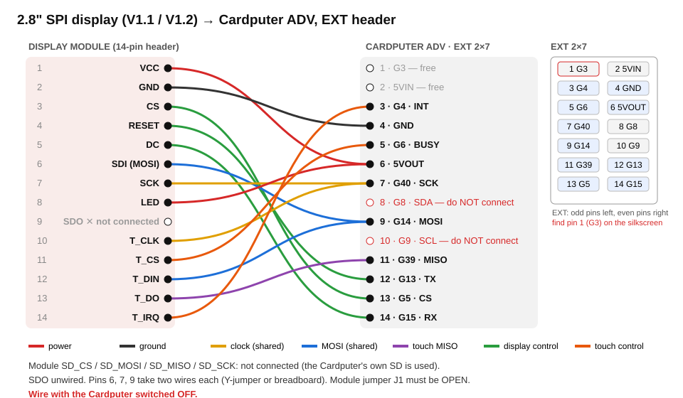

# External display (Cardputer ADV EXT header)

Optional second screen: a 2.8" 320x240 SPI TFT (red "2.8\" TFT SPI 240x320" module, ILI9341 or ST7789V,
XPT2046-class resistive touch) on the **Cardputer ADV** EXT header. The internal ST7789 stays the
primary display. Nothing changes for a device with nothing plugged in.

| Phase | What | Status |
|---|---|---|
| 1 | Runtime detection + 1:1 mirror of the internal 240x135 UI, centred on the external panel | **done** (this doc) |
| 2 | Native 320x240 layouts (launcher, File Commander, editor, media, games), drawn in bands (no framebuffer) | planned |
| 3 | Touch as input: soft keys in the letterbox, gestures on the frame, 4-target calibration | **done** (see Touch) |

Code: `firmware/components/nucleo_ui/` — `extdisp_probe.{h,c}` (pure rules), `extdisp_mirror.{hpp,cpp}`
(the mirror panel), `extdisp_touch.{h,c}` (pure touch: calibration, keys, gestures), `extdisp_chrome.{hpp,cpp}`
(letterbox drawing), `nucleo_extdisp.cpp` (hardware glue). Host gate: `npm run extdisp:test`.

## Supported modules (V1.1, V1.2, ...)

The silkscreen revision does **not** identify the controller: the same red board is sold with an
**ILI9341** or an **ST7789V**. Both are supported.

- `external_controller: "auto"` (default): if the module's **SDO** is wired, the controller is read back
  (ILI9341 *Read ID4* `0xD3` → `93 41`; ST7789V *RDDID* `0x04` → `85 85 52`). Without SDO the ILI9341 is
  assumed (the common chip on these boards) and the test card shows `ili9341?`.
- Force it with `"ili9341"` or `"st7789"`.
- Colours: ILI9341 defaults to invert off, ST7789V to invert **on** (IPS); both BGR. If the test card's
  R/G/B swatches look like a photo negative flip `external_invert`; if red and blue are swapped flip
  `external_rgb`.
- Orientation: the ILI9341 driver uses the ILI9341 MADCTL convention (rotation 1 = `MV`, as Adafruit /
  TFT_eSPI), not Panel_LCD's ST7789 table — with that table the red 2.8" board showed text mirrored
  left-right. A panel that still reads mirrored: `external_mirror: true` (the touch log mirrors with it).
- Touch: XPT2046 or a compatible (HR2046, ADS7846) — anything that answers the ADS7846 temperature
  channels. A module without touch works too (`external: "on"`).

## Wiring (default — no settings needed)



The ADV EXT 2x7 header has 6 free GPIOs (G3, G4, G5, G6, G13, G15) plus the SD card's SPI bus
(SCK G40, MOSI G14, MISO G39). The display joins that bus with its own chip-selects.
LCD CS/DC/RST match the known-good community wiring (guicmg/cardputer_adv_external_screen).

| Module pin | ADV EXT pin | GPIO | Notes |
|---|---|---|---|
| VCC | 6 (5VOUT) | — | the module's regulator makes 3.3 V; logic is 3.3 V |
| GND | 4 | — | |
| CS | 13 | **G5** | |
| RESET | 1 or 12 | **G13** | `rst: -1` if tied to 3.3 V/EN |
| DC | 14 | **G15** | |
| SDI (MOSI) | 9 | G14 | shared with the SD |
| SCK | 7 | G40 | shared with the SD |
| LED | 6 (5VOUT) | — | or a GPIO (`bl`, e.g. G3) to follow screen-off |
| SDO (MISO) | 11 | G39 | **optional** — only for controller auto-ID (see below) |
| T_CLK | 7 | G40 | shared |
| T_DIN | 9 | G14 | shared |
| T_DO | 11 | G39 | shared |
| T_CS | 5 | **G6** | required for auto-detect |
| T_IRQ | 3 | **G4** | optional (polled when -1) |
| SD_* | — | — | **leave unconnected**: the ADV's own slot stays the system card |

**Before powering**: the module's jumper **J1** must be open (closed = regulator bypassed: 5 V straight
into the panel and the touch, whose T_DO then drives 5 V into G39). Find EXT pin 1 (G3) first: reversed,
the header swaps 5 V and GND.

**SDO**: on many of these modules the LCD's SDO does not release the line when deselected. If, with SDO
wired, the SD card stops mounting or files fail, unplug SDO and set `external_controller` by hand. The
touch's T_DO must stay wired (an XPT2046 releases MISO correctly).

Pins in use by the system and refused by the validator: SD CS G12, I2C G8/G9 (keyboard, codec, IMU),
the internal LCD, I2S, IR G44, Grove G1/G2. Only G3/G4/G5/G6/G13/G15 are accepted, never two roles
on one pin.

## Settings (`/sd/system/config/settings.json`, all optional)

```json
"display": {
  "external": "auto",                 // auto | on | off
  "external_controller": "auto",      // auto | ili9341 | st7789
  "external_rotation": 1,             // 1 | 3 (module upside down)
  "external_mirror": false,           // true = left-right flip (text reads mirrored)
  "external_mhz": 27,                 // 1..40; lower it on long jumper wires
  "external_invert": false,           // omit = controller default
  "external_rgb": false,              // omit = controller default (BGR)
  "external_diag": true,              // touch log + boot report (tester build default: on)
  "external_touch": true,             // false = touch only logged, never drives the UI
  "external_touch_cal": [5, ...],     // written by the calibration: [rotation, a, b, c, d, e, f]
  "external_pins": { "cs": 5, "dc": 15, "rst": 13, "t_cs": 6, "t_irq": 4, "bl": -1 }
}
```

The `//` notes are explanations only — remove them in the real file (JSON has no comments).
Read once at boot. Schema: `schemas/settings.schema.json`.

## Detection (boot)

1. `nucleo_extdisp_early()` right after `nucleo_ui_init()`, before the SD mount: weak pull-ups on the
   default CS and T_CS so a plugged module stays deselected while the card initialises.
2. `nucleo_extdisp_boot()` after the SD mount, before networking/httpd (single-threaded):
   - **off** → nothing touches a pin. **Original Cardputer** → refused even when forced on (G5/G6 scan
     its keyboard). Invalid pins → refused.
   - **auto**: if T_CS reads LOW under our pull-up something else drives it (e.g. a LoRa cap's BUSY on
     G6) → back off. Otherwise read the XPT2046 TEMP0/TEMP1 channels at 1 MHz: real chips give a valid
     frame (busy bit and trailing bits 0), TEMP0 in range and TEMP1 > TEMP0. A dead or pulled-up bus can't
     fake that. Then DC must not be driven high by another module (UART TX). Only then the LCD pins move.
   - **on**: attach without a fingerprint (modules with no touch). An empty file `/sd/extdisp-on` does
     the same while the setting is `auto` (tester shortcut; an explicit `off` still wins).
3. Attach: identify the controller (auto), init it on SPI2 (CPU FIFO writes, `dma_channel = 0` — the SD
   driver owns the DMA channel), draw the test card, install the mirror under `d`.

Driver objects are heap-allocated only on attach (~1 KB). Nothing plugged in = no RAM, no task.

### ADV board-detect hardening

M5GFX tells the ADV from the original by G8/G9 pull-ups, but first takes a VAMeter branch when G5 **and**
G6 also read high. A module with pull-ups on both chip-selects would make M5GFX report the **original**
Cardputer → wrong keyboard driver. `nucleo_ui_init()` now re-checks G8/G9 alone when M5GFX says
"original" and logs a warning if it overrides.

## The mirror (`Panel_Mirror`)

A LovyanGFX panel installed in place of the internal ST7789 panel: every write (canvas blits, direct
draws, games, video, modals) goes to the internal panel and, offset by (40,52), to the external one. The
internal panel stays the source of truth for reads, raw commands, DMA, rotation and invert. Alpha blends
and `copyRect` are done on the internal panel and copied across row by row (the external is never read).

**Bus rule.** The external panel shares SPI2 with the SD, and the OS reads the SD *inside* display
transactions (gbemu fetches ROM banks inside its per-frame `startWrite`, the NFV player decodes inside its
own). Holding SPI2 for the outer transaction would deadlock those tasks on their own read. So the
external panel is opened and closed around **each primitive** and never stays open between calls; a pixel
stream split across calls is resumed by re-addressing the window from a tracked cursor. The host gate
asserts both properties after every call.

Cost: each primitive also goes over SPI2 at `external_mhz` (CPU-driven). Canvas-buffered screens push
few, large writes; direct-drawn text pays more. SD-heavy apps (video) share the bus with the mirror, and a
draw waits while the SD driver holds SPI2 for a whole command (including the card's write-busy time).
The panel driver re-uses lgfx's small DMA flip buffer for transparent sprites (re-allocated on width
changes, ≤ ~480 B) — a little DMA-heap churn that exists only while a display is attached.

Residual risk accepted in auto mode: a module on G6 that drives it HIGH (push-pull) during the ~2 ms
probe would briefly fight T_CS; a LoRa cap's BUSY idles LOW at boot and is caught by the pull-up sense.
`external: "off"` never touches the pins.

## Touch (phase 3)

Touch drives the OS through the keyboard: every gesture becomes an ordinary key press queued with
`nucleo_kbd_inject()` and read by the next `nucleo_kbd_read()`, so the launcher, every native app, the
Control Center and the games take touch with no change of their own.

```
+--------+---------------------------+--------+
|  ESC   |   status  (hold 3 s =     |  MENU  |   top band (52 px)
|        |   recalibrate)            | (Tab)  |
+--------+---------------------------+--------+
|      the mirrored 240x135 frame + side strips  |   gesture area
|      tap = Enter   drag = arrows   hold = Back |
+-------+-------+-------+-------+---------------+
|   <   |   ^   |  OK   |   v   |   >           |   bottom band (53 px)
+-------+-------+-------+-------+---------------+
```

- **Soft keys** (letterbox, never written by the mirror): arrows fire on press and auto-repeat while held
  (450 ms, then every 120 ms); OK / ESC / MENU fire on release, only if the finger is still on the key —
  sliding off cancels. The key under the finger lights up.
- **Gestures on the frame**: tap = Enter; drag = arrows with natural scrolling (drag up = Down, drag left =
  Right), one step per 28 px, at most 4 per sample; hold 600 ms without moving = Back.
- **Screen off**: polling drops to 4 Hz; a tap only wakes the screen (an injected Back, which the idle-wake
  path consumes) and that finger is ignored until it lifts.
- **Calibration**: an affine raw→pixel map (absorbs axis swap, mirroring, a slightly rotated film), solved
  from 3 of 4 corner targets and verified on the 4th (rejected and repeated above 20 px). It runs by itself
  the first time a touch panel is seen, and again on a 3 s hold of the status area. Targets sit in the
  letterbox, so the mirrored UI keeps working with the keyboard meanwhile. The result is stored as
  `display.external_touch_cal` and is only used in the rotation it was taken in. Until then the
  uncalibrated phase-1 map applies.
- **Sampling**: Z1/Z2 pressure gate, then 3 X and 3 Y conversions (first of each discarded) → median;
  pressure re-checked after the reads so a lift mid-sample is not a touch. A release needs 2 consecutive
  empty samples (resistive films flicker). 40 ms idle period, 20 ms while touched; with T_IRQ wired no SPI
  read happens at all while untouched.
- **Bus**: the soft keys are drawn by the touch task under a mutex that the mirror also takes around each
  external primitive — never inside one, so the per-primitive bus rule above still holds.
- **Nothing without a display**: the touch state is heap allocated at attach, and the task (6 KB stack)
  and the mutex exist only when a panel came up AND its touch answered. A Cardputer with nothing on the
  header pays one pointer and the keyboard's 8-slot inject ring (~30 B), no task, no CPU.

## Diagnostics (tester)

- **Test card** on the external panel's letterbox when touch is absent or `external_touch` is false:
  controller (`?` = assumed), MHz, R/G/B/W swatches, touch yes/no, rotation. With touch input the soft
  keys replace it and the status area keeps controller, MHz and (diag) the R/G/B/W swatches.
- **`/sd/extdisp-report.txt`** (ADV, mode not off, diag on), rewritten only when its content changes
  (one SD write, not one per boot): firmware, board, mode, controller (read/assumed/configured), pins, pin
  senses, touch TEMP0/TEMP1, raw LCD ID bytes, decision, mirror geometry. Heap before/after goes to the log.
- The report also says whether touch drives input and whether a calibration is stored.
- **`GET /api/status` → `display_ext`**: `mode, active, touch, reason, controller, spi_tx, touch_presses,
  touch_x, touch_y`.
- **Logs** (tag `extdisp`, WARN → `/api/logs` and serial): probe values, LCD ID bytes, decision,
  `touch DOWN #n raw x y -> sx,sy` / `touch UP after N ms (moved dx,dy)` / `touch -> enter|up|...` (diag),
  `touch calibrated: check target off by N px`.

### Tester checklist

1. Wire as above (SD_* and, first time, SDO unconnected). Power off while wiring.
2. Boot. Expected: the internal UI appears centred on the external panel with the test card around it.
3. Check the swatches: R red, G green, B blue, W white. Otherwise set `external_invert` / `external_rgb`.
4. Navigate the launcher, open an app, a game, the Control Center: the external copy must follow.
5. Touch: first boot shows 4 targets in the corners — tap each centre. Then the soft keys and gestures
   drive the UI; `/api/logs` shows `touch -> ...` for each event.
6. Play a video / open the file manager: SD access must keep working (no stalls, no mount errors).
7. Send back `/sd/extdisp-report.txt`, `/api/status`, `/api/logs`, a photo of the panel, and the module's
   controller chip marking if readable.

| Symptom | Likely cause / fix |
|---|---|
| Panel stays white | not attached — read `reason` in the report; or VCC/LED not powered |
| `no display found` | T_CS/T_DO/T_CLK miswired, or no touch on the module → `external: "on"` |
| Colours negative / R↔B | `external_invert` / `external_rgb` |
| Text mirrored left-right | `external_mirror: true` |
| Image noisy or shifted | lower `external_mhz` (e.g. 16), shorten wires |
| Garbled image on an ST7789 board | `external_controller: "st7789"` |
| SD errors after wiring | unplug the module's SDO (see above) |
| Keyboard dead with the module plugged | check the `ui` warning about board detection in the log; report it |

## Not yet

No scaling (1:1, 240x135 centred), no native 320x240 layouts (phase 2), backlight follows
brightness only when `bl` is a GPIO, no hot-plug (detection at boot; plug with the device off).
